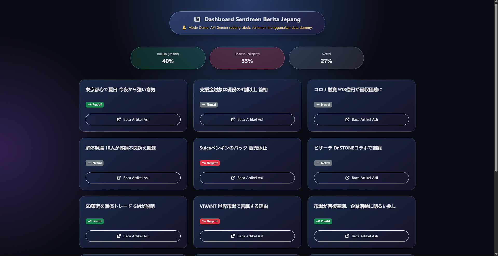

# Japanese Business News Sentiment Analyzer



## Description

Japanese Business News Sentiment Analyzer is a full-stack web application built with Flask. It retrieves Japanese business news in real time from the Yahoo Japan News RSS feed and uses Google Gemini AI, a large language model (LLM), to classify market sentiment as **Bullish**, **Bearish**, or **Neutral**.

The application presents analyzed headlines in a responsive dashboard with sentiment statistics, interactive news cards, and a modern visual experience designed for portfolio presentation.

## Key Features

- **Real-time RSS Feed Parsing**  
  Retrieves the latest headlines from Yahoo Japan News.
- **AI-Powered NLP Sentiment Analysis**  
  Uses the Google Gemini API to classify each headline's market sentiment.
- **Modern Dynamic Island UI**  
  Provides a floating capsule layout with responsive cards and glassmorphism-inspired CSS effects.
- **Intelligent Error Handling**  
  Falls back to realistic mock sentiment data when the Gemini API is unavailable or rate-limited.
- **Responsive Dashboard**  
  Displays sentiment summaries and news cards across desktop and mobile layouts.

## Tech Stack

- **Python**
- **Flask**
- **Google GenAI SDK**
- **HTML5**
- **CSS3**
- **Bootstrap 5**

## How to Run Locally

### 1. Clone the repository

```bash
git clone https://github.com/your-username/bot-berita-jepang.git
cd bot-berita-jepang
```

### 2. Create and activate a virtual environment

Windows:

```powershell
python -m venv .venv
.venv\Scripts\Activate.ps1
```

macOS/Linux:

```bash
python3 -m venv .venv
source .venv/bin/activate
```

### 3. Install dependencies

```bash
pip install -r requirements.txt
```

### 4. Set the Gemini API key

The application accepts the API key through the web form. Alternatively, set it as an environment variable for local development:

Windows PowerShell:

```powershell
$env:GOOGLE_API_KEY="your-gemini-api-key"
```

macOS/Linux:

```bash
export GOOGLE_API_KEY="your-gemini-api-key"
```

Never commit API keys or other credentials to the repository.

### 5. Run the Flask application

```bash
python main.py
```

Open the application at [http://127.0.0.1:5000](http://127.0.0.1:5000).

## Application Flow

1. Enter a Gemini API key on the landing page.
2. The application fetches the latest Japanese news from Yahoo Japan News.
3. Each headline is analyzed by Google Gemini AI.
4. The dashboard displays the headline, source link, sentiment label, and summary statistics.
5. If the Gemini API is unavailable, the application activates its mock-data fallback.
